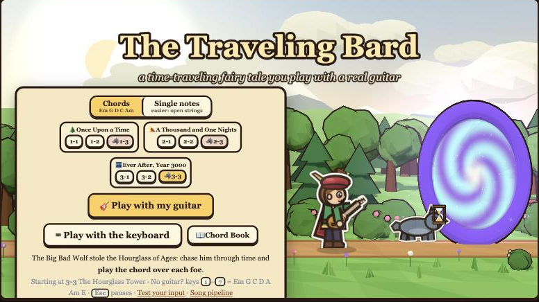
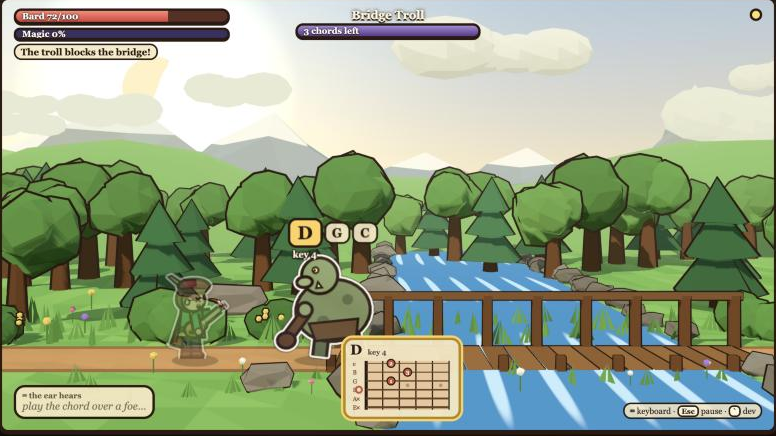
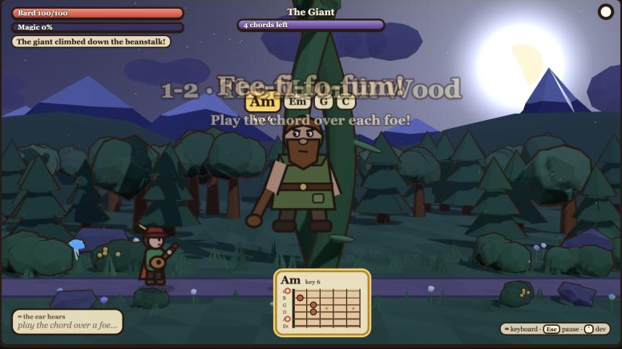
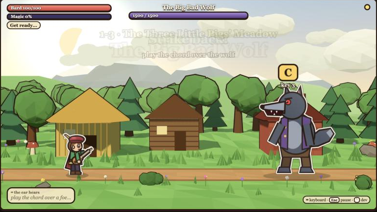
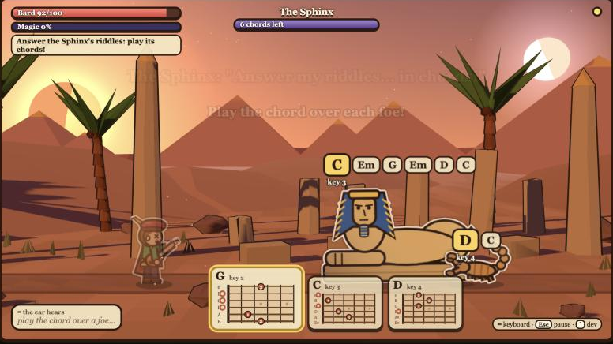
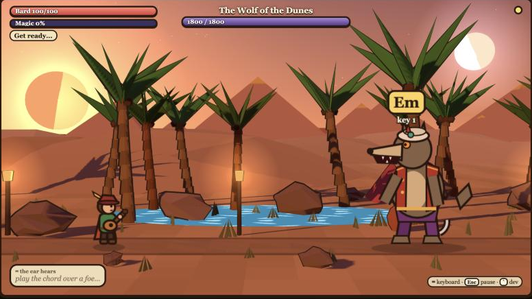
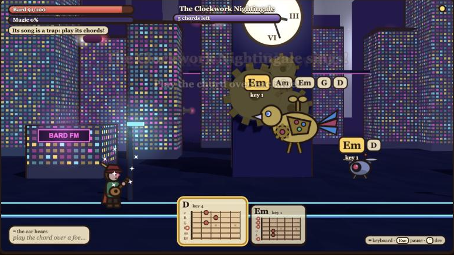

# The Traveling Bard

Two parts in one repo:

1. **The game** (`/play`): *The Traveling Bard*, a time-traveling fairy-tale auto-scroller you play with a real guitar: every foe shows a chord, and playing it slays them. Three worlds through time, each ending in a fight against the Big Bad Wolf to a song from the pipeline.
2. **The song pipeline** (`/preview`, `backend/`): MP3 → note chart + tab/sheet music + backing track (details further down).

## The game

```bash
./dev.sh        # then open http://localhost:3000/play (http://localhost:3000 redirects there)
```



**2.5D:** the worlds are real 3D (Three.js): low-poly, cel-shaded and ink-outlined to match the storybook art, with perspective, parallax, soft shadows, fog, a sky with sun or moon, clouds, fireflies, rivers and neon. The characters are 2D paper cut-outs (white paper edge, soft lifted shadow, light from the top-left) standing on the 3D path, like a pop-up book. The 3D camera is computed from the game camera every frame, so the lane the bard walks on lines up exactly while everything behind it has depth (`frontend/src/game/stage/`).

| | | |
|---|---|---|
|  |  |  |
|  |  |  |

**The story:** the Big Bad Wolf has stolen the Hourglass of Ages and fled through time. The bard follows him across three worlds. Each world has two walking levels and a boss fight against the wolf; beat him and he escapes through a time portal to the next world. Each level is harder than the last.

| World | Levels | Set pieces | Boss |
|---|---|---|---|
| 🌲 *Once Upon a Time* | 1-1 The Enchanted Forest · 1-2 The Moonlit Wood (night) | the troll under the bridge, the gingerbread witch, the giant down the beanstalk, a wolf pack | The Big Bad Wolf, in the Three Little Pigs' meadow |
| 🏜️ *A Thousand and One Nights* | 2-1 The Singing Dunes · 2-2 The Sphinx's Road (dusk) | Ali Baba's cave ("Open, Sesame!", then the thieves pour out), the Sphinx throwing riddles | The Wolf of the Dunes (sandstorm gusts, a jackal pack) |
| 🌃 *Ever After, Year 3000* | 3-1 Gearworks City · 3-2 The Neon Skyway (night) | a laser gate, the Clockwork Nightingale | MECHA-WOLF 3000 (turbo gusts, robo-pups), then the Hourglass comes home |

Each world has its own foes (wolves and goblins; scorpions, thieves, mummies and fire djinn; drones, tin soldiers, mechs and laser turrets), its own art and its own groove (folk strums, desert hand drums and oud, future synths), always in E minor so your chords fit.

**Harder as you go** (`frontend/src/game/levels.ts`): the bard walks faster, foes are faster and hit harder, more foes need several chords, the music speeds up (100 → 118 BPM), and the bosses have more HP, show their howls for less time and call their pack more often. Beating a level unlocks it on the title screen's journey map (saved in the browser; `/play?unlock` opens every level in dev builds).

Inspired by Google's *Magic Cat Academy* doodle, with a guitar instead of a mouse:

- **The bard walks on their own** (auto-scroller). Foes come in from the right.
- **Every foe shows a chord over its head. Play it to slay them.** Every foe showing that chord is hit at once. Any foe may be a tougher one that needs 2–3 chords, played in any order (more likely in later levels). Set pieces block the path until you've played all their chords; casters (the witch, djinn, turrets, the Sphinx, the Nightingale) throw things that also carry chords.
- **Chords:** Em, G, D, C, Am. Em and G come first; the rest join as you go. They're all in E minor, the key of the music, so whatever you play fits.
- **The music follows you:** when you play a chord (or note), the backing's bass and harmony move to it on the next half-beat, so your playing blends in.
- **Fairy godmother:** appears now and then (and when you're low). Play **A** to heal 25%.
- **Happily Ever After:** slaying fills the magic meter. When it's full, play **E** (major) and every foe on screen vanishes.
- **Rhythm bonus:** chords on the beat score Perfect (more magic). Wrong chords just fizzle; nothing is punished.
- **Single notes mode** (title screen) is easier: foes ask for open strings E A D G; B heals, C is the super.
- **No guitar?** Keys `1`–`7` = Em G C D A Am E. In notes mode, `Z X C V B N` = E G A B D C, and every note piano-style on the home row: `A`=C `W`=C# `S`=D `E`=D# `D`=E `F`=F `T`=F# `G`=G `Y`=G# `H`=A `U`=A# `J`=B. Key hints show under each chord when you play with the keyboard.
- **Practice mode** (pause menu or Chord Book) widens the timing, and in chords mode the chord's root note alone also counts.
- **Bosses:** pick a processed song from the pipeline (or the world's built-in demo).
  - In *howl* phases, the easy-chart notes become howls on the song's beat. In chords mode each howl carries **the chord the song is playing at that moment**: the song's harmony is worked out beat by beat from every transcribed note (longer, louder and lower notes count more, the song's key breaks ties) and fitted to the seven chords the mic knows. In single-notes mode each howl is **the song's real note** (any of the 12, with where to play it). Play it as the howl reaches you to parry it back at him. `npx tsx scripts/song-chords.ts <jobId>` prints the chords a song will use.
  - In *pack* phases, his pack charges in, the wolf shows his own chord (play it to strike him), and his huff-and-puff gust carries a chord you play to blow it back.
- **Chord helper:** the chords you need right now (the next howl or the nearest foe first, plus the heal or super chord when it's on offer) sit at the bottom of the screen with their fretboard diagrams and finger numbers (1 index … 4 pinky), so beginners never have to remember a shape. Single notes show where to play them (string and fret).
- `Esc` pauses. The in-game **Chord Book** shows every chord with a fretboard diagram. Headphones work best with the mic; playing out loud through the laptop, tick **Laptop speakers** on the tuning screen or in the pause menu (see below).

### Note input engine

`frontend/src/lib/input/` (`detector.ts` + `noteInput.ts`), built on the tuner's Essentia.js loader and AudioWorklet pipeline (`src/lib/audio/`, mic constraints with noise suppression and auto gain off, and echo cancellation off unless *Laptop speakers* is on):

- **Onsets:** the pick's high-frequency transient, or a jump in loudness. This works even over ringing strings. A sustained note never re-triggers, and events are at least 120 ms apart.
- **Notes:** Essentia PitchYin on the audio *after* the onset; two agreeing confident readings = one note (~50 ms after the pluck).
- **Chords:** strummed strings make PitchYin unsure, so the HPCP chroma is matched against Em E G C D A Am once the strum has finished (~80 ms). A chord is emitted only if it's clearly ahead of the runner-up. Chord changes over ringing strings are matched on the *new* energy.
- **Hammer-ons / slides** (1–4 semitones, while a note rings) also count as new notes.
- Every `NoteEvent` is `{ type, pitchClass, midi?, chord?, time, confidence, source }`, timestamped at the pluck (accurate to ~1 ms).

Measured with a synthetic guitar through the real pipeline (`/input-test` → *Run self-test*, or `npx tsx scripts/detector-bench.ts` offline):

| | detected | pluck → event |
|---|---|---|
| single notes | 10/10 | ~50 ms |
| Em chord | 9–10 of 10 | ~85 ms |
| E then G notes | 20/20 | ~50 ms |
| chord changes Em G D C Am (0.9 s apart, old strings still ringing) | 9–10 of 10 | ~85 ms |

**On a real guitar recording** (`npx tsx scripts/real-audio-check.ts <jobId> [guitar|input] [--highpass=200] [--ref=twinkle]`, which runs the detector over a WAV from the song pipeline): on the *Twinkle Twinkle* play-along (real guitar, single notes, E major), scored against the true melody, the detector **catches 40 of the 42 notes and names 95% of them correctly** when the guitar is on its own (the backing's bass filtered out). Two fixes came out of this recording. Real plucks rise slower than the synthetic ones the "slow attack" check was tuned on, so it now allows ~90 ms (it caught 36 of the 42 before, and no bench lets more noise through). And a note played over a bass note can read as the bass (B4 over E2 heard as E: B4 is E2's 6th harmonic), which matters when the game's music leaks from laptop speakers; a low reading whose loudest partial is its 3rd/5th/6th/7th, with a bass's strong fundamental and weak octaves, now counts as that partial. With the backing's bass left in, right notes went from 67% to 80%; on a guitar lesson recording the rule changed 17 notes, each to a note the transcription has there, and left the real open-A and low-E notes alone. Try yours on `/input-test`; the thresholds live at the top of `detector.ts`.

### Listening only to your guitar

The browser's own voice processing is off (it dulls a guitar), so the game filters what isn't guitar itself:

- **Voices, clicks, room noise** (`detector.ts`): a note's pitch must hold steady (speech glides), its level must peak fast and not keep swelling (voices swell), and it must still ring when the decision is made (clicks die at once). Onsets must stand 3× above the background noise, which is learned whenever nothing has been played for 1.5 s. Hearing the note or chord that's already ringing again needs a real re-pluck (the level jumps), and once you've played a few notes, sounds adding under 30% of what your playing adds are ignored.
- **The game's own sound** (`echoGuard.ts`, `src/lib/audio/outputLog.ts`): the game logs every sound it plays (when, and which notes) and measures its own output. At game sounds you're not playing over, the mic learns how much of the game reaches it (about 0 with headphones). A mic event that starts with a game sound (±45 ms) and adds no more than about what that sound would add at the mic (×1.25, or ×1.05 during a recorded boss song, whose notes the game doesn't know) is ignored. Both sides are measured above ~200 Hz, since speakers differ most in bass.
- **Laptop speakers** (checkbox on the tuning screen and in the pause menu, remembered in the browser): halves the music volume and turns on the browser's echo cancellation. The echo guard runs either way.
- `/input-test` shows the background noise, how many sounds were ignored as not-guitar, how much game sound reaches the mic and how many echoes were ignored.

Offline benches (from `frontend/`; each takes `--trace`, and `DETECT='{...}'` / `ECHO='{...}'` to try other thresholds):

| | what it checks | now |
|---|---|---|
| `npx tsx scripts/detector-bench.ts [44100]` | guitar recall, synthetic self-test | 49/50 at 48 kHz (one chord change heard as G), 50/50 at 44.1 kHz |
| `npx tsx scripts/noise-bench.ts` | voices, singing, keyboard clicks, fan hiss and leaked strums between guitar notes, as loud as the guitar | fake events 21 → 12 (speech syllables 0, singing 1, clicks 1); guitar 45/50 |
| `npx tsx scripts/echo-bench.ts [--onbeat] [--flat] [--song] [--skew=25]` | the game's groove leaking from laptop speakers at normal / loud / very loud volume | fake events 17 → 0, 38 → 1, 50 → 2; guitar within 1 of no guard; nothing ignored with headphones |

### The lute's coach (Gemini + Tiger Data)

The bard's lute hears every chord you play, and after each world (or a defeat) it coaches you. A card on the End screen gives one tip and a short drill, and **The Lute's Notebook** has the rest: every tip, the drill's chord boxes, and your progress across runs.

- **Tiger Data** keeps every judged input as a time series (`backend/app/tiger.py`). The game posts them in small batches while you play (`frontend/src/lib/coach/log.ts`). Each row stores what the ear heard, what was wanted, hit or miss, timing against the beat, confidence and latency.
  - `plays` and `runs` are hypertables, columnstore-compressed and segmented by player.
  - `chord_hourly` is a real-time continuous aggregate (accuracy per chord per hour) that Tiger refreshes every 10 minutes.
  - The coach's history comes from SQL over these tables: accuracy per chord per day and per run, chord changes you miss on the first strum (a `lag()` window), mix-ups (C heard as Am), timing, and every bard's numbers for the last 24 hours.
- **Gemini** (`backend/app/coach.py`) reads only those measured facts, plus the chord shapes and fingerings the game teaches. It answers in a fixed JSON schema (headline, praise, focus, tips, drill, goal), which the card draws. It names the physical cause of a mix-up: C heard as Am means the ring finger isn't pressing the A string at fret 3.
- **Offline first:** both services are optional. Without keys, or with no wifi, the game plays the same, and the lute gives its built-in tips (`frontend/src/lib/coach/advice.ts`). These use the same numbers and explain a mix-up by comparing the two chord boxes string by string. Plays are anonymous: a random id per browser, no audio.

Setup: `./setup.sh` creates `backend/.env` from `backend/.env.example`. Fill it in:

```bash
GEMINI_API_KEY=...        # https://aistudio.google.com/apikey
GEMINI_MODEL=gemini-3.8-flash
TIGER_DATABASE_URL=postgresql://tsdbadmin:<password>@<host>:<port>/tsdb?sslmode=require   # Tiger Cloud > your service
```

Restart `./dev.sh`. The tables are created on the first connection, and `GET /health` shows `coach: {tiger, gemini}` (`ok`, `off` or the error). To try it without Tiger Cloud, run a local TimescaleDB: `docker run -d -p 5432:5432 -e POSTGRES_PASSWORD=pw timescale/timescaledb:latest-pg17`, then set `TIGER_DATABASE_URL=postgresql://postgres:pw@localhost:5432/postgres`.

### Deploy (https://thetravelinglute.tech)

The frontend is a static Next.js site, so it deploys to Vercel as is:

1. On [vercel.com](https://vercel.com), **Add New → Project**, import this GitHub repo, set **Root Directory** to `frontend`, and deploy (Next.js is detected; no env vars needed).
2. **Settings → Domains**: add `thetravelinglute.tech` (and `www`, redirecting to it). Vercel shows the DNS records to add.
3. At get.tech (where the domain was registered): **Manage Orders** → the domain → **Manage DNS**. Add an **A** record for the bare domain with the IP on Vercel's domain card, and a **CNAME** for `www` with the card's target. Remove any other A or AAAA records on the bare domain (the parking page). Vercel turns on HTTPS by itself once DNS has spread (minutes to a few hours). The mic needs HTTPS.

On the public site the game, the ear, every world, the demo boss songs and the lute's built-in tips all work. Song uploads and the Gemini / Tiger Data coach need the Python backend: run `./dev.sh` and play at http://localhost:3000, or host the backend and set `NEXT_PUBLIC_API_URL` in Vercel (and add the site to `GS_CORS_ORIGINS` if it isn't https://thetravelinglute.tech).

### Tuning and dev tools

- `frontend/src/lib/combat/spells.ts`: which chords foes use and when, the heal/super chords, how often foes are tougher, song note → chord mapping.
- `frontend/src/lib/combat/rhythm.ts`: Perfect/Good windows; practice-mode widths.
- `frontend/src/game/levels.ts`: the worlds, every level's spawn schedule, set pieces and difficulty, and each boss (HP, howl timing, pack, song).
- `frontend/src/game/entities/Enemy.ts`: foe speed, damage, base chord count, what casters throw. `scenes/Journey.ts`: the walking levels and their set pieces. `scenes/Boss.ts`: parry window and damage. `scenes/worlds.ts`: how each world looks.
- `frontend/src/game/art.ts`, `art-worlds.ts`: all the 2D art, drawn in code; `art-kit.ts` gives characters the paper cut-out finish.
- `frontend/src/game/stage/`: the 2.5D stage. `Stage3D.ts` (renderer and the camera that follows Phaser's), `worlds3d.ts` (the forest, desert and future worlds, set pieces, arenas), `scaffold.ts` (sky, fog, lights and shadows, ground and path, clouds, portal, fireworks), `kit.ts` (toon materials, ink outlines, low-poly props, instancing, particles, water). If WebGL 3D isn't available the scenes fall back to their 2D backdrops.
- `frontend/src/lib/game-audio/music.ts`: the procedural backing for each world and how it follows the player (`follow()`).
- `npx tsx scripts/spells-check.ts`: checks the chord-to-slay rules and the level data (difficulty rises level to level).
- `npx tsx scripts/coach-check.ts`: checks the lute's coach without a backend (what a miss was aimed at, the run summary, the built-in tips). `cd backend && .venv/bin/python -m pytest -q tests/test_coach.py` checks the Gemini side (facts, schema clean-up, fallbacks) with no network.
- `scripts/playtest-bot.js`: paste into the console on `/play` and it plays the journey with the keyboard, through the portals (set `__botSpeed` / `__botMiss` for a slower, sloppier player). Dev builds expose `window.__game`, `window.__playLevel(i)` (jump to a level), `window.__noteInput()`, and `window.__synthPlay([...])`, which plays synthesized plucks through the mic pipeline.
- Leaving `/play` stops the mic (tracks stopped, AudioContext closed).

---

# Song → chart + sheet music (pipeline)

Turns an MP3 (or, optionally, a YouTube link) into level data for the side-scrolling guitar game:

| File | What it is |
|---|---|
| `chart.json` | time-stamped notes for **easy / medium / hard** (game level data) |
| `score.alphatex` | tab + standard notation, rendered in the browser by alphaTab (one track per difficulty) |
| `score.musicxml` | same score for MuseScore / Guitar Pro |
| `transcription.mid` | raw Basic Pitch transcription |
| `guitar.wav` | the isolated part the player plays |
| `backing.mp3` | the song with that part removed (`backing + guitar = original mix`) |

Everything runs locally: backend at http://localhost:8000, frontend at http://localhost:3000. The pipeline needs no cloud, auth or database. Only the game's optional coach talks to Gemini and Tiger Data (see above).

## Setup (once)

You need **Python 3.11**, **Node 20+** and **ffmpeg**. The setup script checks for them and prints the install command for anything missing:

| | macOS | Windows | Linux |
|---|---|---|---|
| Python 3.11 | `brew install python@3.11` | `winget install Python.Python.3.11` | `sudo apt install python3.11 python3.11-venv` |
| Node 20+ | `brew install node` | `winget install OpenJS.NodeJS.LTS` | NodeSource / `nvm` |
| ffmpeg | `brew install ffmpeg` | `winget install Gyan.FFmpeg` | `sudo apt install ffmpeg` |

```bash
./setup.sh          # macOS / Linux
```
```powershell
.\setup.ps1         # Windows
```

This creates `backend/.venv`, installs everything, runs `npm install`, and **downloads all models up front** (`backend/setup_models.py`: Demucs `htdemucs_6s` weights into `backend/models/`, plus a Basic Pitch warm-up). After that the pipeline works with no internet. On Windows with an NVIDIA GPU it installs the CUDA build of PyTorch.

## Run

```bash
./dev.sh            # macOS / Linux   (Ctrl+C stops both servers)
```
```powershell
.\dev.ps1           # Windows
```

Open **http://localhost:3000/preview**, drop in an MP3, watch the stages, then check the result: a lane view synced to the audio (toggle `guitar.wav` / `backing.mp3`, turn on "click on notes" to hear where the notes land), the alphaTab score for the selected difficulty, and download links for all six files. `?job=<id>` in the URL reopens a finished song.

Demucs runs on an **NVIDIA GPU (CUDA)** if there is one, else **Apple Silicon (MPS)**, else **CPU**, and falls back to CPU if the GPU fails. The device is printed at startup and shown on the page.

## Pre-process demo songs (CLI)

```bash
cd backend
.venv/bin/python -m pipeline song.mp3 --out out/song/
.venv/bin/python -m pipeline song.mp3 --out out/song/ --source other       # guitar stem too weak
.venv/bin/python -m pipeline song.mp3 --out out/song/ --min-amplitude 0.35 # fewer ghost notes
```

| Flag | Default | |
|---|---|---|
| `--source guitar\|other\|vocals\|bass\|piano\|mix` | `guitar` | which stem to transcribe. A non-guitar stem is also removed from the backing track |
| `--onset-threshold` | 0.5 | Basic Pitch: higher = fewer notes |
| `--frame-threshold` | 0.3 | Basic Pitch: higher = shorter notes |
| `--min-note-ms` | 80 | drop shorter notes |
| `--min-amplitude` | 0.25 | drop quieter notes (0–1) |
| `--device auto\|cuda\|mps\|cpu` | `auto` | Demucs device |
| `--force` | | ignore the cache |

Re-running the same file with the same settings is instant (cached by SHA-256 of the input). Changing a threshold re-runs everything except Demucs, because stems are cached separately in `stems/`.

## API

| | |
|---|---|
| `POST /jobs` | multipart `file=<mp3/wav>` (optional `source`, `title`, `force=1`), or JSON `{"youtubeUrl": "..."}` → `{jobId, status, cached, ...}` |
| `GET /jobs/{id}` | `{status: queued\|running\|done\|error, stage, progress (0–1), error, failedStage, warnings, stemLevels, timings, files}` |
| `POST /jobs/{id}/rerun` | JSON `{"source": "other", "force"?: false}`: same song, different stem. Takes seconds, because the Demucs stems are reused |
| `GET /jobs/{id}/files/{name}` | one of the six files (`?download=1` for an attachment) |
| `GET /jobs` | recent jobs |
| `GET /health` | device, YouTube on/off, coach status (`tiger`, `gemini`, `model`) |
| `POST /plays` | the lute's coach: `{playerId, runId, plays: [...], run?}` → stored in Tiger Data (accepts `text/plain`, so the game needs no CORS preflight) |
| `POST /coach` | `{playerId, runId, run}` → `{advice, source, model, history, services}`: Gemini's advice (null if off or failed) and the bard's history from Tiger Data |
| `GET /progress/{playerId}` | `?mode=chords\|notes` → `{history, services}` |

Interactive docs: http://localhost:8000/docs. Jobs run one at a time in a background thread inside the FastAPI process. Each job lives in `backend/data/jobs/<first 16 hex of sha256>/` (plus `-<source>` for non-guitar sources), and unfinished jobs are re-queued when the server restarts.

## Warnings

Finished jobs can carry `warnings` (shown as a yellow banner in the preview and printed by the CLI):

- **`cut_off`**: the music stops early and the rest of the file is digital silence (typical of a failed online video-to-MP3 conversion). The silent tail is trimmed, so the chart and backing track end with the music; upload a complete copy to get the whole song.
- **`weak_stem`**: the transcribed stem is quiet (under 20% of the song's level, or present in under 25% of it), so the chart will be thin. Comes with `suggestSources`: up to two stems that are clearly present (in the order other → piano → vocals → bass), then `mix`. The preview turns each into a one-click "Re-run with …" button.
- **`few_notes`**: fewer than 0.5 notes per second on hard.

`stemLevels` gives each stem's share of the song's level and how much of the song it's present in, so you can see where the instruments ended up.

## chart.json

```jsonc
{
  "version": 1,
  "song": { "title": "...", "durationSec": 162.3, "bpm": 127.6, "timeSignature": [4, 4], "offsetSec": 1.81 },
  "beats": [1.81, 2.28, ...],            // beat times (s); beats[0] is the first downbeat
  "audio": { "backing": "backing.mp3", "guitarStem": "guitar.wav" },
  "difficulties": { "easy": [Note], "medium": [Note], "hard": [Note] },
  "meta": { "source": "guitar", "tuning": [...], "grids": {...} }   // extra, informational
}
// Note
{ "t": 2.28, "dur": 0.23, "beat": 1.0, "midi": 64, "name": "E4", "string": 1, "fret": 0, "lane": 1, "velocity": 80 }
```

- `beat` is a fractional beat index: `beat k` = `beats[k]`, beat 0 = first downbeat = `offsetSec`, a new bar every 4 beats. Pickup notes before the first downbeat have negative beats.
- `string` 1 = high E … 6 = low E (standard tuning, frets 0–12). `lane` = `string` for now; remap it in the game.
- `velocity` is MIDI-style 1–127. Notes are sorted by `t`.

### How the difficulties are built

All three start from the same cleaned notes: short (<80 ms) and quiet notes are dropped, and notes outside the guitar's range are moved by octaves. Each difficulty then snaps onsets to its own grid. A note too far from that grid is **dropped instead of dragged**, so every note stays aligned with the audio.

- **hard**: 1/16 grid, all notes (chords up to 6 strings).
- **medium**: 1/8 grid, at most 2 simultaneous notes (the two highest).
- **easy**: 1/4 grid, only the highest note per slot (no chords), at most 2 notes per beat (in practice 1). If a beat has nothing on it, the off-beat 8th can be used. Fingering favors open strings and low frets.

Strings and frets are assigned greedily, keeping the hand close to where it was on the previous note (easy: lowest frets).

## Project layout

```
backend/
  pipeline/            # stages: audio.py (ingest), separate.py, beats.py, transcribe.py, chart.py, notation.py
    runner.py          # runs the stages: timing, progress, caching, "Stage 'x' failed: ..." errors
    __main__.py        # CLI
    youtube.py         # optional, isolated (ENABLE_YOUTUBE=true)
  app/                 # FastAPI server + job worker
    tiger.py           # Tiger Data: schema (hypertables, continuous aggregate) and the coach's history queries
    coach.py           # Gemini: the facts it reads, the JSON schema it answers in, fallbacks
    coach_api.py       # /plays, /coach, /progress
  setup_models.py      # download / verify models for offline use
  tools/               # make_test_clip.py, eval_chart.py
  tests/               # pytest: chart + notation rules, the coach (no network)
  data/jobs/<hash>/    # job inputs and outputs (gitignored)
frontend/              # Next.js + TypeScript; preview page at /preview
  src/lib/coach/       # the lute's memory (log.ts), run summary, built-in tips
  src/components/game/Lute.tsx   # the End screen card and the Lute's Notebook
  src/components/pipeline/   # PreviewPage, LaneView (canvas + audio sync), ScoreView (alphaTab)
```

## Settings (environment variables)

| Variable | Default | |
|---|---|---|
| `ENABLE_YOUTUBE` | `false` | allow `{youtubeUrl}` jobs (yt-dlp, audio only). Any failure returns "Couldn't fetch that link, please upload an MP3 instead." |
| `GS_DEVICE` | `auto` | force `cuda` / `mps` / `cpu` |
| `GS_ONSET_THRESHOLD`, `GS_FRAME_THRESHOLD`, `GS_MIN_NOTE_MS`, `GS_MIN_AMPLITUDE` | see CLI | API-side tuning |
| `GS_MAX_DURATION_SEC` | 480 | longer songs are rejected |
| `NEXT_PUBLIC_API_URL` | `http://localhost:8000` when the page is opened on localhost, else none | frontend → backend URL. On the public site (no backend) the game calls nothing: demo boss songs and built-in tips. Set it to a hosted backend's URL, or `off` |
| `GEMINI_API_KEY` | | the lute's advice (Gemini). In `backend/.env` |
| `GEMINI_MODEL` | `gemini-3.8-flash` | falls back to `gemini-flash-latest` if the model isn't available |
| `TIGER_DATABASE_URL` | | Tiger Data service URL (any TimescaleDB works). In `backend/.env` |
| `GS_CORS_ORIGINS` | | extra frontend origins, comma-separated (localhost:3000 and https://thetravelinglute.tech are always allowed) |
| `NEXT_PUBLIC_COACH` | `on` | `off`: send nothing, built-in tips only |

## Testing

```bash
cd backend
.venv/bin/python -m pytest -q                                  # chart/notation rules (fast)
.venv/bin/python tools/make_test_clip.py out/test_clip.mp3     # 30 s synthetic song with known notes
.venv/bin/python -m pipeline out/test_clip.mp3 --out out/test_clip/
.venv/bin/python tools/eval_chart.py out/test_clip/ --truth out/test_clip.truth.json
```

Measured on an M1 Pro (MPS):
- 30 s clip: about 12–15 s total.
- 2:42 full song: about 31 s (Demucs about 24 s).
- Cached re-run: instant.

On the synthetic clip, chart notes are a median of 7 ms from the true note times, and 100% of matched notes are within 50 ms.

## Known limits

- Assumes 4/4. The first downbeat is a heuristic (the beat position with the most kick/bass energy), so it can be off by a beat or two on sparse songs.
- Transcription quality depends on the guitar stem. On mixes where Demucs puts the guitar into `other` (keys-like or heavily effected guitars), use `--source other`.
- Hard mode on strummed songs is dense (every chord tone). Raise `--min-amplitude` or `--onset-threshold` to thin it out.
- Windows/Linux setup follows the same steps but has only been run on macOS so far. Basic Pitch uses ONNX Runtime there; that path was checked on macOS and gives the same notes as CoreML.
